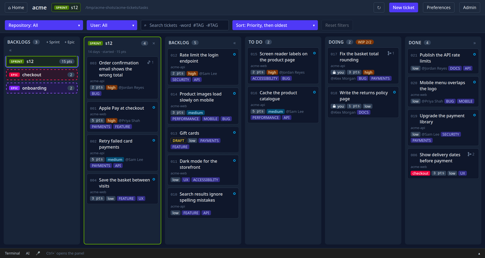
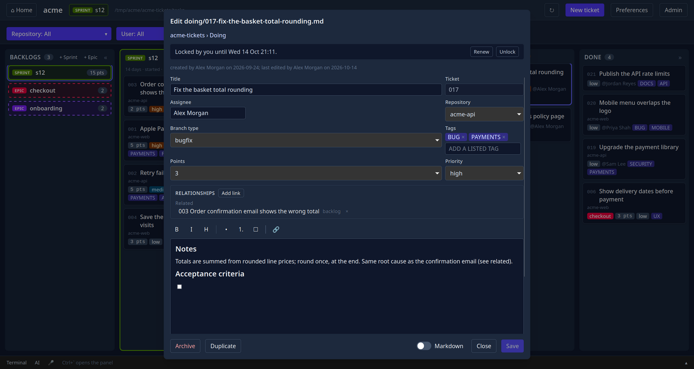
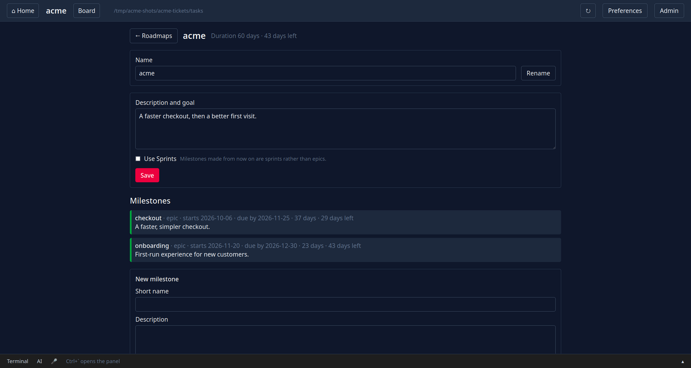
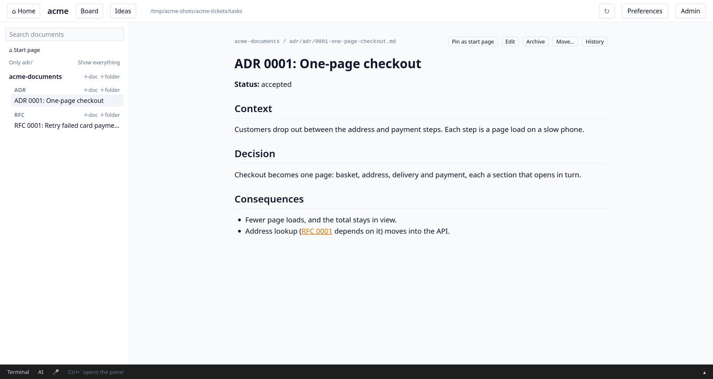
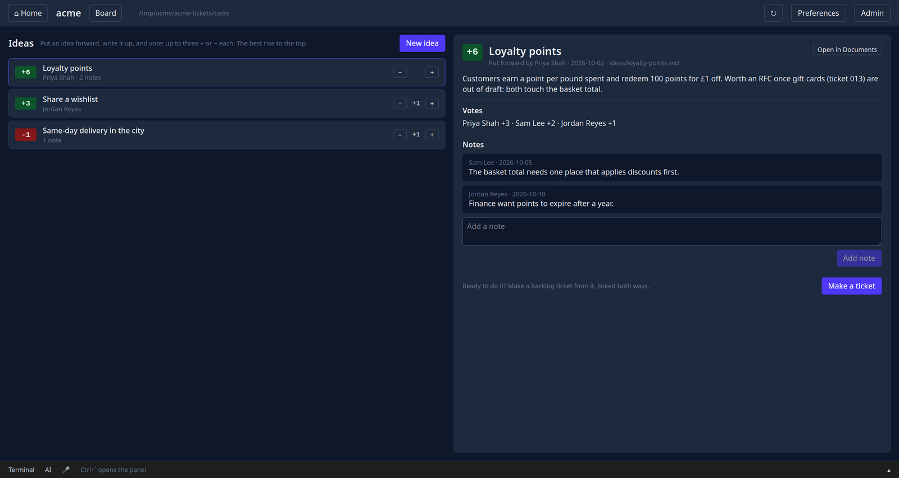
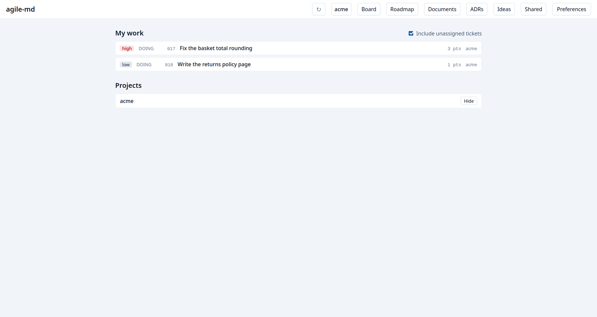
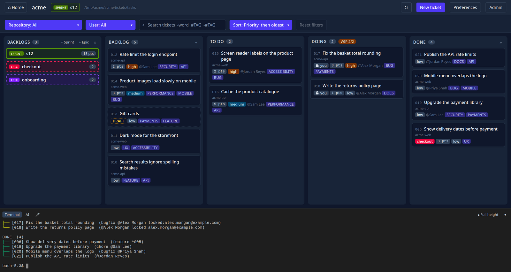

<p align="center">
  <picture>
    <source media="(prefers-color-scheme: dark)" srcset="pages/logo/agile-md-dark.svg">
    
  </picture>
</p>

# agile-md

**An open source, fully featured, multi-project agile management system for
individuals and teams.**

**[Website](https://agile-md.github.io/amd/)** ·
[Install](#install) ·
[User guide](docs/user-guide.md) ·
[Releases](https://github.com/agile-md/amd/releases) ·
[Contributing](CONTRIBUTING.md)

Your tickets, documents and ideas live in your own git repositories, as
markdown, right beside your work: not in someone else's cloud. agile-md works
well with AI, but AI is never a requirement; it's just as useful to a team or
a solo developer without it.



## Main features

- **Kanban boards** across several projects and several boards, with
  optional sprints and automatic ticket prioritisation to help manage your
  workflow.
- **Customisable tickets** with an optional draft status, parent and child
  tickets nested to any depth, relationships, priorities, due dates,
  recurring tickets and tags for filtering and sorting.
- **Your own board**: add, remove and rename columns, and set the workflow
  that suits your team.
- **Roadmaps and milestones** that set up their epics or sprints for you, to
  help manage larger projects and delivery dates.
- **Ideas**, to incubate new ideas and solve problems together, and turn them
  into backlog tickets, epics or sprints.
- **Documents** your team reads and writes, and can pin when they're reading
  or working from them: everything you need to be productive and informed.
- **Everything is backed by git**, giving you a full, intelligible audit
  trail and recovery when required.
- **Markdown in your repositories**, so your tickets, documents and ideas are
  accessible to your team, and to your AI.
- **A landing page** showing your priorities across all your projects, with
  statistics and navigation.
- **A desktop app** with rich text editing, and a **command line** for those
  who prefer it.
- **A built-in terminal**, and optional AI integration.
- **Optional speech to text**, run entirely on your machine.
- **Free to use:** no servers, no hidden costs. Your data is where you need
  it, and in your control.

## In more detail

### Tickets

- **One flexible ticket**, rendered from templates each project can change.
- **Fields:** priority, story points (1, 2, 3, 5, 8, 13), assignee from the
  project's users, tags, the repository it's about, and a due date.
- **Recurring tickets:** a monthly report or a yearly renewal comes round
  again: done makes the next one, due one interval on.
- **Typed links:** requires, related, parent and child, clone, supersedes,
  each written on both tickets and changeable later. A tree draws what each
  ticket requires and relates to, and cards show how many links they have.
- **Save and New:** found a ticket depends on one that doesn't exist yet?
  Save it and make the missing one, already linked.
- **Who created it** is recorded; **who last edited it** comes from git.
- **Tags** are uppercase and can be limited to the project's own list; DRAFT
  and TRIAGE are built in.
- **Drafts** can't leave the backlog until they're marked ready.
- **Branches:** a ticket with a branch type gets its own git branch when it
  moves to todo.
- **Search and filters** by tag, assignee, repository and text.

### Workflow rules

- **One column at a time:** backlog → todo → doing → done, unless the team
  allows other moves.
- **Your own columns:** add Triage, Review, Released and the like, rename,
  reorder and remove them; each has a kind that decides what it does, and
  reset puts the standard four back.
- **Done waits** for the tickets a ticket requires and for its children.
- **A WIP limit on doing** (2 unless changed), with a deliberate override.
- **Locks:** a ticket is yours while it's in doing and is released when it
  leaves; someone else's lock is only broken on purpose.
- **Every change is committed and pushed**, and boards stay in step: amd
  catches up before a change, replays it if someone pushed first, and warns
  when many tickets vanish or history is rewritten.

### Planning

- **Epics and sprints**, both optional; a started sprint takes nothing more
  and gives nothing back, and can't start while it needs a ticket outside it.
  Backfill a running sprint from the backlog when it runs short, and close it
  when it ends: a report with its burn-up goes into your documents.
- **Auto priority:** a ticket is at least as urgent as what requires it,
  rises as its due date nears, and the **Automatic** sort shows what's
  needed first.
- **Roadmaps:** one per board, made of milestones that create its epics or
  sprints, with working days, time left and whether each is on track. A
  milestone's start and due dates can be changed later.
- **My work:** your todo and doing tickets across every project on your
  machine, and work to pick up when you have none.

### Documents and ideas

- **A documents repository per project** for ADRs, RFCs and docs, plus an
  optional one every project shares. Changes go straight to main, with
  history and restore.
- **Write in amdui:** rich text or markdown, folders, moves that keep links
  working, archiving, a pinned start page and search, and your own pinned
  documents, first in your list on every machine.
- **Ideas** before they're tickets: everyone votes up to ±3 and adds notes,
  and an idea becomes a backlog ticket in one click, or (for the project's
  admins) an epic or a sprint with the idea's write-up as its description
  (`amd idea ticket <idea> --as epic|sprint`).

### Teams and projects

- **`amd init`** creates a project's repositories on GitHub; **`amd join`**
  gives a teammate the project and adds them as a user.
- **Several repositories per project**, and several projects side by side;
  a new repository can be made from the ticket that needs it.
- **Admin** settings are committed for the team; **Preferences** are your
  own, on your machine.
- **Archive a project** to make it read-only, on GitHub too if you like.

### Bringing work in, and getting it back

- **GitHub issues** arrive as TRIAGE tickets, each one only once.
- **Import** tickets from another board and documents from a folder.
- **`amd recover`** brings back deleted or abandoned tickets; **`amd
  renumber`** fixes duplicate numbers.

### The desktop board

| | |
|---|---|
|  |  |
|  |  |
|  |  |


- **Drag and drop**, with the rules shown while you drag.
- **A landing page** with My work and every project, each with its tickets
  raised, done and closed over 7, 30 or 90 days and its running sprint's
  burn-up and burn-down (`amd stats` on the command line).
- **Live:** changes made anywhere (the command line, an editor, a pull) show
  within a second.
- **A bottom panel** with a terminal and an AI tab running your own AI tool.
- **Speech to text**, optional and entirely on your machine.
- **An Editor button**, themes, accent colours and zoom.
- **Update check:** an orange bar in amdui tells you when a newer release
  is out, with its notes, how to update, and Later.

### AI, if you want it

- **`amd mcp`** lets any MCP-capable AI tool (Claude Code, Copilot, Cursor,
  Codex, Gemini CLI) read the board, documents, ideas and what's on screen,
  and change tickets under the same rules, each change committed. It never
  abandons tickets, breaks locks or changes settings.
- **Nothing built in:** amd holds no API keys, and nothing runs unless your
  AI tool starts it.

### Command line

- **Everything the board does is a command**, safe in scripts and CI: it
  never prompts without a terminal.
- **Shell completion** for bash, zsh and fish, epic names included, and
  `amd log` for a board's history.

Everything is explained in the [user guide](docs/user-guide.md).

## Install

Runs on **Linux and macOS** (x86_64 and arm64), and needs **git 2.29 or
later**. In a terminal:

```bash
curl -fsSL https://raw.githubusercontent.com/agile-md/amd/v4/install.sh | bash
```

That installs two commands, **`amd`** (the command line) and **`amdui`**
(the desktop board), into `/usr/local/bin` when it can, otherwise `~/bin`,
and on Linux adds the board to your application menu. Run it again to
update. To choose the folder or pin a version, pass them after `bash -s --`:

```bash
curl -fsSL https://raw.githubusercontent.com/agile-md/amd/v4/install.sh | bash -s -- --dir ~/.local/bin --version v4.5.0
```

If your system isn't one agile-md runs on, the installer says why and
changes nothing: on Windows, install it inside
[WSL](https://learn.microsoft.com/windows/wsl/install). On Linux the desktop
board needs WebKitGTK 4.1; if it's missing, the installer names the package
to add, and `amd` works without it.

To uninstall, run `amd-uninstall` (the installer puts it beside `amd`). It
removes the programs and the menu entry, then asks whether to remove your
agile-md settings too; `--all` removes them without asking. Your projects,
in your git repositories, are never touched. Installed before it existed?
The installer does the same:

```bash
curl -fsSL https://raw.githubusercontent.com/agile-md/amd/v4/install.sh | bash -s -- --uninstall
```

Building from source is in [CONTRIBUTING.md](CONTRIBUTING.md).

## Quick start

Start a project, or join one, from the folder you keep projects in:

```bash
amd init acme              # make acme-tickets and acme-documents on GitHub and clone them here
amd join acme              # …or join a project someone else made
```

Then, from any of its repositories (or the folder holding them):

```bash
amd new "Publish to Marketplace"
amd todo 1                 # backlog -> todo
amd doing 1                # todo -> doing: it's yours (locked) while you work on it
amd done 1                 # doing -> done
amd board                  # every column
amdui                      # the desktop board
```

The [user guide](docs/user-guide.md) covers tickets, links and
dependencies, your own columns, epics and sprints, the desktop board,
documents, ideas, roadmaps, statistics, several repositories, teams and AI
tools.

## Why a directory instead of one big TODO.md?

A single file gets unwieldy once tasks have real content, and every edit is a
merge-conflict magnet. Separate files keep tasks self-describing, diffable and
independently movable, while the folders give an unambiguous board.

## Development

How to build agile-md, run its checks and work on the desktop board is in
[CONTRIBUTING.md](CONTRIBUTING.md); [CLAUDE.md](CLAUDE.md) describes the
architecture.

## Contributing

Bugs and ideas go in [issues](https://github.com/agile-md/amd/issues/new/choose);
they're pulled into the maintainers' board automatically and triaged there.
Pull requests are welcome: [CONTRIBUTING.md](CONTRIBUTING.md) has the build,
the checks CI runs, the branch and commit names, and how to become a
maintainer. Everyone taking part follows the
[code of conduct](CODE_OF_CONDUCT.md). Report a security problem privately,
through the repository's Security tab, not in an issue: see
[SECURITY.md](SECURITY.md).

## Licence

MIT: see [LICENSE](LICENSE). Contributions are accepted under the same
licence.
